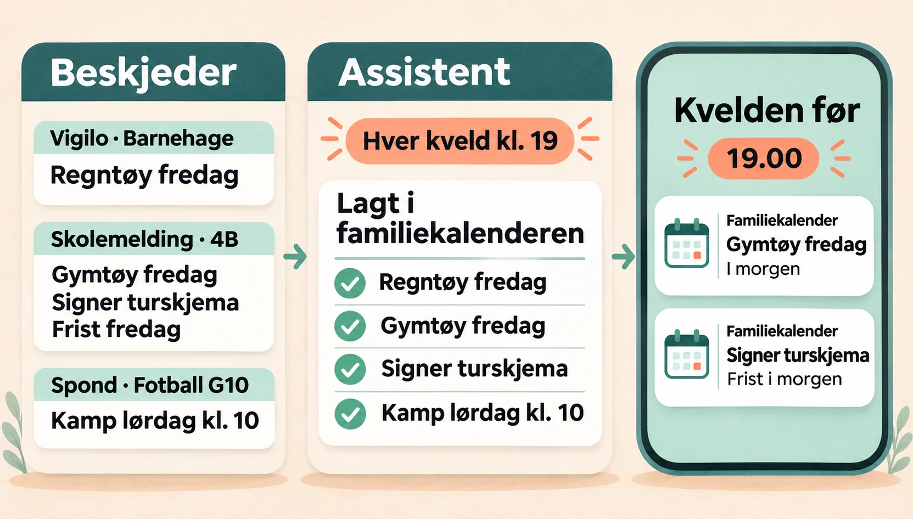
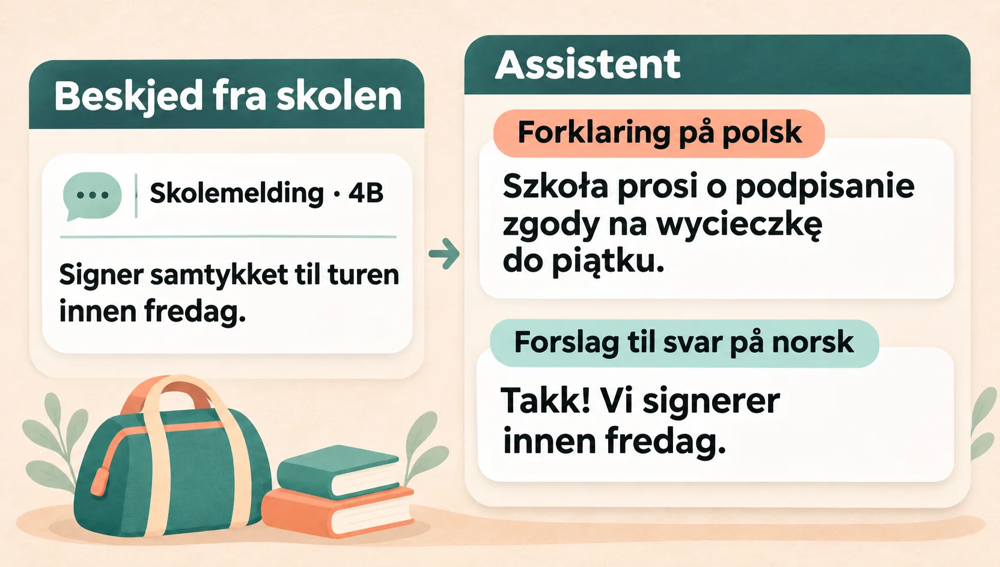

# familiekilder-mcp

Koble AI-assistenten din til beskjeder, aktiviteter og vedlegg fra skole,
barnehage og fritid. Programmet er en **MCP-server**: en kobling som lar
assistenten lese fra tjenestene du bruker, med din egen innlogging.

*Illustrasjon med oppdiktede data. Assistenten må ha en planlagt oppgave og en
egen kalenderkobling. Ved lokal kjøring må Macen være på. Se også [prøveordningen med egen vert](docs/alltid-pa.md).*

<!-- Tjenestelisten er hentet fra sources.REGISTRY. -->
Støtter Vigilo, Skolemelding, Spond, Hoopit, IST Home, Flyt (barnehage) og Gmail.
Vi jobber med støtte for MyKid og for skole og SFO i Flyt.

Savner du en tjeneste? Opprett en sak på GitHub med navnet på tjenesten,
eller send en pull request hvis du vil bidra med en kobling.

## Kom i gang

Dette er en lanseringskandidat for versjon 1.0. Du trenger Python 3.11 eller
nyere og [Brave](https://brave.com/) for å logge inn på tjenestene.

Få kodeagenten til å installere for deg. Åpne Codex i ChatGPT-appen eller Claude og lim inn prompten under.

> Installer familiekilder-mcp fra https://github.com/Item4747/familiekilder-mcp i ~/familiekilder-mcp. Prosjektet krever macOS, Python 3.11+ og Brave. Kjør scripts/setup i bakgrunnen. Veiviseren åpnes automatisk. Innlogging og resten av oppsettet gjør jeg selv der.

Eller installer selv ved å følge [oppsettsveiledningen](docs/kom-i-gang.md).

MCP-serveren tilbyr bare lesing. Innloggingene lagres på Macen ved lokal bruk,
eller på din egen vert når du uttrykkelig flytter dem dit. Innhold
assistenten leser, kan sendes til AI-leverandøren du bruker. Gmail bruker
Googles offisielle API. De øvrige koblingene er uoffisielle.

## Slipp å huske alt selv

Koble assistenten også til kalenderen din. Da kan den gå gjennom alt fra
skole, barnehage og fritid og legge det inn i familiekalenderen. Det dere må
gjøre, får egne oppføringer med varsel kvelden før, så telefonen minner dere
på det. Bruker dere en delt kalender, får begge foreldrene det samme.
Assistenten trenger en egen kobling som gir den tilgang til å opprette
kalenderhendelser.

> Gå gjennom alt fra skole, barnehage og fritid. Legg det som skjer, i
> familiekalenderen. Legg det vi må gjøre, inn som egne oppføringer med varsel
> kvelden før: ting som skal være med, skjemaer som skal signeres og påmeldinger
> med frist. Sjekk hva som står der fra før, så ingenting kommer inn to ganger.

## La assistenten passe på hver dag

Codex og Claude Desktop kan kjøre en oppgave fast hver dag. Lag en planlagt
oppgave med prompten over, og legg til teksten under. Da holder assistenten
kalenderen oppdatert uten at du må be om det. Kjøring om kvelden gir tid til å
vaske gymtøy eller kjøpe gave før neste dag. Macen må være på når oppgaven
kjører. For betalt Claude Cowork finnes også planlagt skykjøring med
[egen vert](docs/alltid-pa.md#en-kveldsoppgave-i-skyen); dette må prøves med
den ekte koblingen før du stoler på rutinen.

> Gjør dette hver kveld kl. 19. Oppdater oppføringer når tid eller sted er
> endret, og slett bare noe når en beskjed sier at det er avlyst. Legg inn en
> oppføring i dag hvis en innlogging har utløpt.

## Forstå beskjedene på ditt språk

Assistenten kan forklare beskjeder på språket du foretrekker eller skrive
dem om til enklere norsk. Det gjør det lettere for flere foreldre å få med
seg hva som skjer, følge opp frister og svare på beskjeder.

> Les de nye beskjedene fra skolen. Forklar på polsk hva vi må gjøre
> og hvilke frister som gjelder. Foreslå et kort svar på norsk.

*Illustrasjon med oppdiktede data. Svaret er et forslag du selv kan sende.*

## Hvor fungerer det?

Du installerer MCP-serveren på Macen din og bruker den fra
[Claude Desktop](https://claude.com/download) eller
[ChatGPT-appen for Mac](https://chatgpt.com/download/) på samme maskin.
I ChatGPT velger du **Codex** og **This computer**. Lokal Codex-kjøring i CLI
eller IDE kan også koble til. Vanlig chat i nettleseren eller på mobilen kan
ikke koble seg direkte til den lokale stdio-serveren.

Som [prøveordning](docs/alltid-pa.md) kan du kjøre serveren på en liten
Linux-vert med HTTPS og OAuth. Da kan eksterne klienter nå den uten at Macen
er på. Innlogging skjer fortsatt på Macen. En første prøve på Fly.io
bekreftet utrulling, flytting av innloggingene for Spond og Hoopit og
tilkobling fra Claude og ChatGPT på nett og iPhone og fra Codex CLI. ChatGPT
krever en egnet plan; koblingen er prøvd på Pro. Kildene med BankID-innlogging
og drift over tid er ennå ikke prøvd på en slik vert.

[Hva tjenestene støtter](docs/service-capabilities.md) ·
[Feilsøking og bidrag](docs/kom-i-gang.md#hjelp-og-bidrag) ·
[Apache-2.0](LICENSE)
